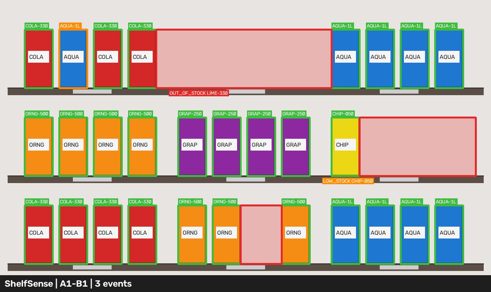
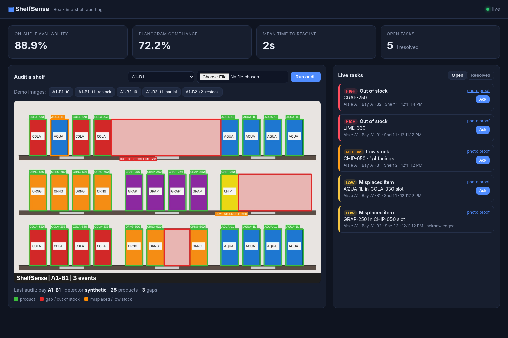
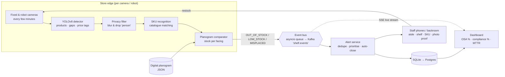

# ShelfSense: Real-Time Shelf Auditing with Vision AI

**Everseen Computer Vision AI Hackathon · E-Cell IIT Bombay · Problem Statement 1: Shelf Auditing and Real-Time Stockouts**
**Team Void:** Udit Awasthi, Sunil Maurya

> Shelf cameras become a live restocking loop: every image becomes a counted planogram, every gap becomes a prioritised staff task, and every task **closes itself** once a later image proves the fix.


*Green = product (with recognised SKU), red = empty facing / out of stock, orange = misplaced item / low stock.*



---

## The problem
Manual shelf audits happen a few times a day. Between rounds nobody is watching the shelf, so a product that runs out stays empty for hours: lost sales, frustrated shoppers, and planogram drift that nobody notices. Dense shelves and look-alike packs make manual counting slow and error-prone.

## Our solution
Fixed and robot-mounted cameras capture shelf images every few minutes. A YOLO-based detector finds **products, empty gaps and price tags**, and a SKU-recognition model matches each item against the product catalogue. We compare detections with the **digital planogram** to compute stock per facing and raise three events:

| Event | Rule | Priority |
|---|---|---|
| `OUT_OF_STOCK` | 0 facings of the slot's SKU | HIGH |
| `LOW_STOCK` | 0 < facings ≤ slot's low-stock threshold | MEDIUM |
| `MISPLACED` | a known SKU sitting in another SKU's slot | LOW |

Events stream to an alert service that pushes prioritised tasks (aisle, shelf, SKU, photo proof) to staff, then **auto-closes each task once a later image confirms the fix**. A dashboard tracks **on-shelf availability**, **planogram compliance** and **mean time to resolve**. Edge inference keeps bandwidth low, and no customer faces are stored.

## What works in this repo (today)
- `scripts/demo.py`: fully offline, deterministic end-to-end run over 5 synthetic shelf images across 2 bays: detects 3 + 2 issues, then auto-closes all 6 events as restock images arrive.
- **FastAPI service**: `POST /audit` (image upload) → detection → planogram comparison → SQLite → live event stream (SSE) → dashboard.
- **Dashboard**: upload or one-click demo images, annotated result, live prioritised task list with Ack and photo proof, metric cards.
- **Real photos** go through Ultralytics YOLOv8 (pretrained `yolov8n` by default, fine-tune script for SKU-110K included). COCO `person` boxes are **blurred before any image is saved**.
- Tests for the comparator, gap heuristic, auto-close logic and the API flow (`pytest`).

## Architecture



**Auto-close loop:** each event has a stable key `shelf_id/slot_id/type`. When a new image of the same bay is audited, open events whose key no longer appears are resolved (`planogram/comparator.py::reconcile`), and time-to-resolve feeds the MTTR metric.

### How the code maps to the pitch
| Pitch | Implementation | File |
|---|---|---|
| YOLO detector (products, gaps, price tags) | Ultralytics YOLOv8 wrapper; `gap`/`price_tag` classes used if the fine-tuned model has them | `detector/yolo.py`, `detector/train.py`, `detector/sku110k.yaml` |
| Empty gaps | Heuristic: cluster boxes into shelf rows by y, flag horizontal spaces > 1.2× median facing width | `detector/gaps.py` |
| SKU recognition | **Baseline**: HSV colour-histogram matching against catalogue reference crops (swap in an embedding model behind the same interface) | `detector/sku.py`, `data/catalog/` |
| Planogram compare → 3 events | Pydantic schema + comparator with priority, bbox and evidence image | `planogram/` |
| Kafka event stream | In-process asyncio bus; **Kafka producer adapter** (aiokafka) behind `SHELFSENSE_KAFKA=1` | `api/bus.py` |
| Alert service + auto-close | Dedupe by event key, ack, auto-resolve on a later clean image | `api/main.py`, `planogram/comparator.py` |
| Dashboard (OSA, compliance, response time) | Static HTML/JS served by FastAPI, live via SSE | `dashboard/` |
| Edge inference, low bandwidth | CPU-only `yolov8n` (6 MB); only events + one annotated evidence JPEG leave the device | `detector/` |
| No customer faces | `person` boxes blurred before saving; never written to DB | `detector/privacy.py` |

### Detector modes
`SHELFSENSE_DETECTOR=auto|synthetic|yolo` (also a `detector` form field on `/audit`).
- **auto** (default): generated sample images (few flat colours) → `synthetic` OpenCV detector, so the demo is deterministic offline; real photos → YOLO if `ultralytics` is installed.
- **yolo**: `SHELFSENSE_WEIGHTS=path/to/best.pt` to use a fine-tuned model (default `yolov8n.pt`, auto-downloaded on first use).
- A camera with no planogram entry (e.g. `shelf_id=CAM-NEW`) still works: each detected gap becomes an `OUT_OF_STOCK` task with SKU `UNKNOWN`.

## Quickstart
```bash
python -m venv .venv && source .venv/bin/activate      # Windows: .venv\Scripts\activate
pip install torch torchvision --index-url https://download.pytorch.org/whl/cpu   # optional, CPU torch for YOLO
pip install -r requirements.txt

python scripts/demo.py          # offline end-to-end demo -> out/ and docs/demo.png
pytest -q                       # tests
uvicorn api.main:app --reload   # then open http://localhost:8000
```
In the dashboard click **A1-B1_t0** (3 tasks appear), then **A1-B1_t1_restock** (all 3 auto-close). Or with curl:
```bash
curl -F image=@data/sample/A1-B1_t0.png -F shelf_id=A1-B1 localhost:8000/audit
curl localhost:8000/metrics
```
Docker: `docker build -t shelfsense . && docker run -p 8000:8000 shelfsense`

### Demo output (abridged)
```
=== Audit 1: A1-B1_t0.png (bay A1-B1, detector=synthetic) ===
    28 products, 3 gaps, 3 issues -> 3 new, 0 auto-closed
    NEW  [OOS ] HIGH   aisle A1 shelf 1 A1-B1-L1-S2  LIME-330  0 facings
    NEW  [LOW ] MEDIUM aisle A1 shelf 2 A1-B1-L2-S3  CHIP-050  1/4 facings
    NEW  [MISP] LOW    aisle A1 shelf 1 A1-B1-L1-S1  AQUA-1L   found AQUA-1L in COLA-330 slot
...
=== Audit 4: A1-B1_t1_restock.png ===  -> 3 auto-closed
=== Metrics ===
    t0  : on-shelf availability 94.4%  planogram compliance 72.2%
    now : on-shelf availability 100.0%  planogram compliance 100.0%
OK: every event was auto-closed by a later image.
```

## API
| Method | Path | Description |
|---|---|---|
| `POST` | `/audit` | multipart `image` + `shelf_id` (+ optional `detector`). Runs detection + planogram comparison, stores events, auto-closes fixed ones. Returns new/resolved events and an evidence image URL |
| `GET` | `/events?status=open\|acked\|resolved` | Task list, highest priority first |
| `POST` | `/events/{id}/ack` | Staff acknowledges a task |
| `GET` | `/metrics` | On-shelf availability %, planogram compliance %, mean time to resolve (s), counts |
| `GET` | `/events/stream` | Server-Sent Events: `created` / `acked` / `resolved` |
| `GET` | `/audits/latest` | Latest audit per bay |
| `GET` | `/shelves`, `/samples`, `/health` | Helpers for the dashboard |
| `GET` | `/` | Dashboard · interactive API docs at `/docs` |

**Metrics:** OSA = slots not out of stock ÷ slots (latest audit per bay). Compliance = slots with correct stock above threshold and no misplaced items ÷ slots. MTTR = mean(resolved_at − created_at).

## Planogram format
`data/sample/planogram.json`: store → bays (`shelf_id`, `aisle`) → levels (`shelf`, pixel `y_range`) → slots (`slot_id`, `sku`, pixel `x_range`, `expected_facings`, `low_stock_threshold`). Pixel ranges are calibrated once per fixed camera. See `planogram/schema.py`.

## Fine-tuning on SKU-110K
```bash
python -m detector.train --data SKU-110K.yaml --epochs 50 --imgsz 1024 --batch 8   # Ultralytics downloads ~11 GB
python -m detector.train --epochs 1 --fraction 0.01                                # smoke test
export SHELFSENSE_WEIGHTS=runs/shelfsense/sku110k/weights/best.pt
```
To detect empty facings directly, label a few hundred images with a `gap` class (see `detector/sku110k.yaml`); the API uses model gaps and the heuristic together.

## Privacy
- Only shelf regions matter. Any COCO `person` detection is **Gaussian-blurred** in the image before it is annotated or saved as evidence, and person boxes are discarded (only a count is returned, nothing is stored in the DB).
- Inference is designed to run on the edge device; only small JSON events and one annotated JPEG per audit leave the store.

## Limitations (honest)
- The demo runs on **synthetic** shelves so it is deterministic offline; real-photo accuracy depends on fine-tuning (pretrained COCO `yolov8n` only knows generic objects like bottles and cups).
- SKU recognition is a colour-histogram **baseline**: fine for distinct packs, weak on look-alike packaging.
- Planogram slots use fixed pixel ranges per camera (no homography / robot localisation yet).
- Single-process SQLite + in-process bus; Kafka path is an adapter, not load-tested.

## 48-hour roadmap
| Hours | Milestone |
|---|---|
| 0–6 | Fine-tune YOLOv8n on SKU-110K (Colab GPU), evaluate mAP on val, export to ONNX for edge CPU |
| 6–14 | Label ~300 images for `gap` and `price_tag`; train 3-class model; price-tag OCR stub |
| 14–22 | Replace colour baseline with an embedding SKU matcher (metric-learning CNN on catalogue pack shots, FAISS index) |
| 22–30 | Kafka (Redpanda in docker-compose) + alert consumer; staff PWA with push notifications, photo proof and "mark done" |
| 30–38 | Camera calibration (homography) so planograms are in shelf coordinates; robot-mounted multi-frame stitching |
| 38–44 | Postgres, multi-store dashboard, OSA/compliance trends and per-SKU stockout heatmap |
| 44–48 | Benchmark on a Raspberry Pi 5 / Jetson Nano (FPS, bandwidth), polish deck and demo video |

## Repository layout
```
api/          FastAPI app, SQLite store, event bus (+ Kafka adapter)
dashboard/    static HTML/CSS/JS dashboard
data/         generate_samples.py, catalog/ (SKU references), sample/ (images + planogram)
detector/     YOLO wrapper, synthetic detector, gap heuristic, SKU baseline, privacy blur, train.py
planogram/    schema, comparator (+ auto-close), auditor (one-call pipeline)
scripts/      demo.py
tests/        pytest suite
docs/         demo.png, dashboard.png
```

## Team
**Team Void**
- **Udit Awasthi**: B.Tech CSE, PSIT Kanpur
- **Sunil Maurya**

License: MIT
